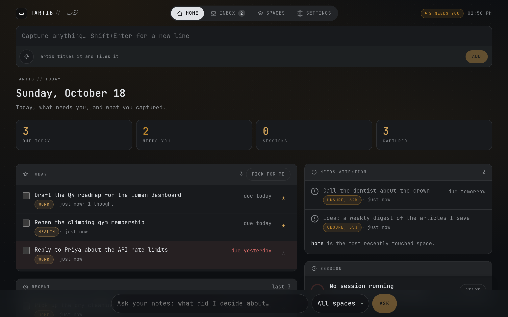
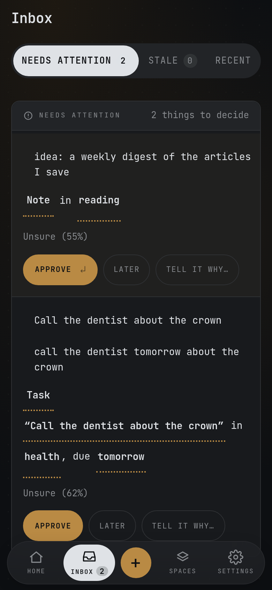
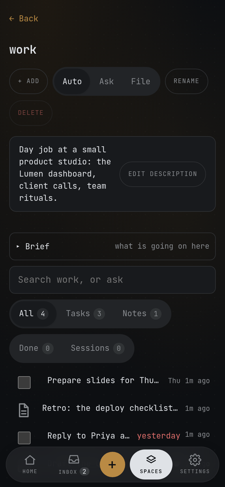
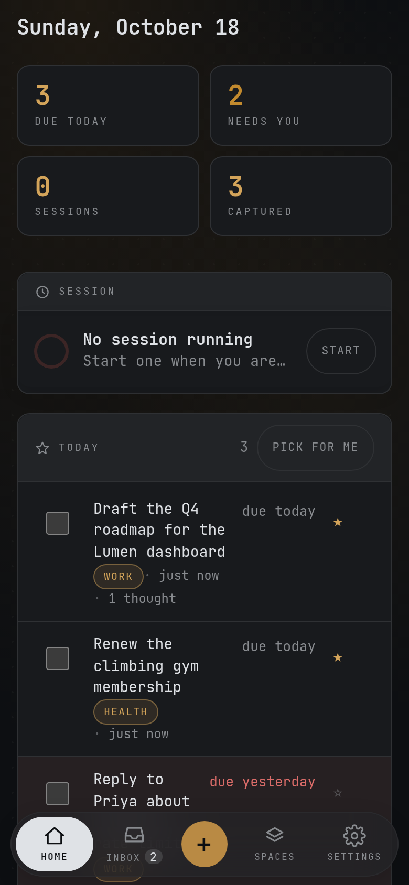
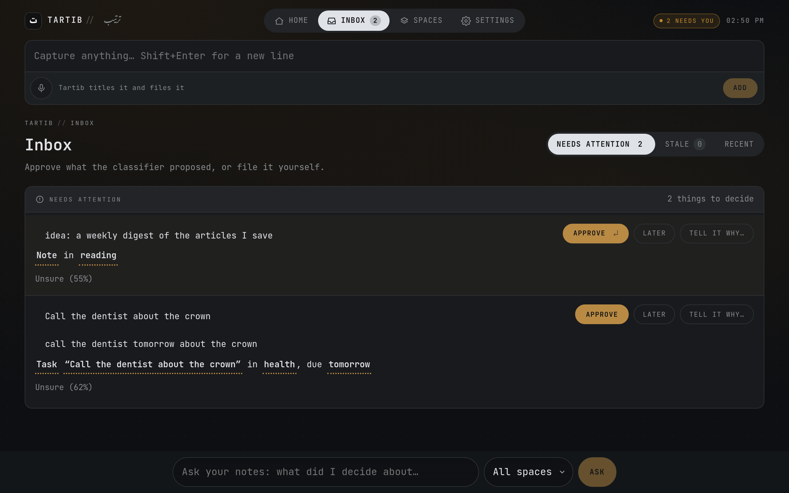
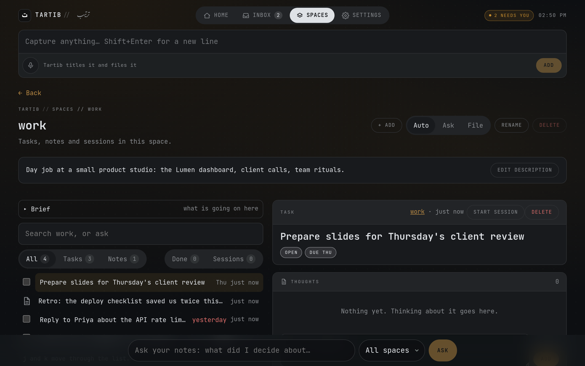

<p align="center">
  
</p>

<h1 align="center">Tartib <sub>(ترتیب)</sub></h1>

<p align="center">
  <b>Type anything into one box. It gets filed into your own spaces.</b><br>
  A background AI call sorts every capture into tasks and notes, with due dates and reminders.<br>
  Your text is never rewritten. Classification only proposes the fields around it.
</p>

<p align="center">
  <a href="https://github.com/smkamranqadri/tartib/actions/workflows/test.yml"></a>
  <a href="LICENSE"></a>
  <a href="https://hub.docker.com/r/smkamranqadri/tartib"></a>
  
  
</p>

You think of something, and it should take two seconds to put down without deciding where it
goes. Tartib stores what you typed once, exactly as typed, and returns right away. Then a
classifier splits it into separate items ("A, B, and C" becomes three) and files each one into a
space. Confident proposals are filed on their own. The rest wait for you in **Needs Attention**,
and anything ending in `?` is answered from your notes instead of being filed.

It is single user with one password, runs in one container in about 42 MiB, and is deliberately
small.

<p align="center">
  
</p>

<p align="center">
  
  
  
</p>

## How to use it

You need Docker and a [Codex CLI](https://github.com/openai/codex) login on the host. Tartib fits
in 512 MB.

```sh
git clone https://github.com/smkamranqadri/tartib.git && cd tartib
codex login                 # once, on the host; compose mounts ~/.codex into the container
cp .env.example .env        # set TARTIB_PASSWORD at least
docker compose up -d
open http://localhost:8000
```

Then type into the box at the top. For example:

| You type | What Tartib does |
| --- | --- |
| `call the dentist tomorrow` | files a task with tomorrow as its due date |
| `book the boiler service, and buy filters for the jug` | files two tasks, each holding its own words |
| `paint for the hall: harbour grey, eggshell` | files a note in the space it fits |
| `what did I decide about the roadmap?` | answers from your notes and files nothing |

If you have no Codex login, set `TARTIB_AI_COMMAND=off` and every capture waits in Needs
Attention for you to file by hand. If Codex fails (an outage, a usage limit), the capture is kept
and waits the same way. Once Codex is back, `python -m tartib.reclassify --attention` runs them
again.

**Running it for real**, on a server behind HTTPS with push working, is covered in
[docs/deploying.md](docs/deploying.md). It explains how to generate the password, the cookie key,
the push keys and the AI login, lists the full environment table, and shows what to set in
CapRover. A prebuilt image is published as
[`smkamranqadri/tartib`](https://hub.docker.com/r/smkamranqadri/tartib).

## Contributing

Bug reports and fixes are very welcome. Start with
[an issue](https://github.com/smkamranqadri/tartib/issues) for anything larger than a small fix.

Read [CONTRIBUTING.md](CONTRIBUTING.md) before your first pull request. Tartib has a few hard
rules (the AI never rewrites your text, capture never waits on AI, no projects or tags, and
nothing nags), and a patch that breaks one is declined however good it is. Each rule, and every
exception to it, is argued in writing in [`kis/`](kis/).

## Security

Tartib has one password and one user, and that password is the whole security model. Put the app
behind HTTPS, use a long random password, and read the
[security section of the deploy guide](docs/deploying.md#security) before exposing it.

Please report vulnerabilities privately, as described in [SECURITY.md](SECURITY.md), and not in a
public issue.

## What you get

Four screens:

- **Home** shows what is due today, overdue, starred, reminded or worked on in a session today,
  along with what needs a decision and what you captured last.
- **Inbox** holds the classifier's proposals to approve or reject, plus tasks that have gone stale.
- **Spaces** is where things live. Each space has a description, a brief and search, and a search
  ending in `?` asks a question instead.
- **Settings** shows how this copy is set up: classifier, usage, reminders and spaces.

<p>
  
  
</p>

It also has:

- **Thoughts:** a running log under any item, for what you learned while working on it.
- **Links:** typing `[[` links one item to another, and the classifier can suggest links for you
  to keep or skip.
- **Pick for me:** the AI stars up to three open tasks to work on next and says why.
- **Sessions:** 25-minute pomodoros, started on a task or on nothing.
- **Push:** for exactly three things, which are a reminder you set, one daily digest, and a
  session ending.
- **Offline capture:** it installs as a PWA, and a capture made with no signal is queued and sent
  later, never twice.

## Use it from your coding agents (MCP)

Set `TARTIB_MCP_TOKEN` (32 characters or more, for example `openssl rand -hex 32`) and Tartib
serves an MCP endpoint at `/mcp`. Agents can then list spaces, search, read items, add notes and
tasks, add thoughts, mark tasks done, set due dates and reminders, and make small edits, all
through the same write paths as the app. There are eighteen tools.

```sh
claude mcp add --transport http tartib https://tartib.example/mcp \
  --header "Authorization: Bearer $TARTIB_MCP_TOKEN"
```

The server's own instructions tell agents to search before adding, to ask before creating a
space, and to edit or delete only when you ask.

## Capture from anywhere

Every `/api` route accepts the password as a bearer token, so shortcuts and scripts need no login
flow.

```sh
curl -X POST https://tartib.example/api/capture \
  -H "Authorization: Bearer $TARTIB_PASSWORD" \
  -H "Content-Type: application/json" \
  -d '{"text": "call the dentist tomorrow"}'
```

On iOS, an Apple Shortcut with "Get Contents of URL" (POST, a JSON body and that header) plus a
Share Sheet trigger lets you capture from any app.

## How filing works

1. `POST /api/capture` stores the text once as a capture and returns `{id}` immediately.
2. A background task runs `codex exec` (ephemeral, read-only sandbox, JSON output schema) with the
   text, the current time in your zone, and your spaces with their descriptions.
3. Codex returns one proposal per independent item in the text:
   `{text, shape, space, title, due, remind_at, confidence}`, each with its own verbatim excerpt.
4. A question is not stored. It is answered from your items, and the answer is kept on the
   capture. A space outside your list becomes null. A null space, or confidence below
   `TARTIB_AUTOFILE_CONFIDENCE` (0.85 by default), goes to Needs Attention. Everything else is
   filed.
5. If the CLI is missing, fails or times out, you get one plain note in Needs Attention with the
   error. Restarting mid-classify loses nothing, because pending captures are re-queued on
   startup.

**Reject** discards the proposal and keeps the item in Needs Attention with no space. **Approve**
needs a space. A decision never deletes anything, and the capture keeps the original text either
way.

**Ask** runs SQLite FTS5 over the question's content words and gives the top matches to Codex with
a prompt that allows answering only from them. It never writes anything. A space's **brief** is
the same machinery with a fixed question, cached until the space changes.

## Offline, reminders and sessions

Tartib is a PWA. Add it to your home screen and it opens as an app, offline included. A capture
is written to a local queue before it is sent, so the box clears at once. One that cannot go out
shows as **waiting to send** and goes when the network comes back. Each capture carries a
`client_id`, so a retry is never a second capture. Reading still needs the network.

Web Push needs HTTPS, the VAPID keys from [docs/deploying.md](docs/deploying.md), and the
container running. A laptop with the lid shut sends nothing. A session asks **Done · Not
finished · Abandoned** when it ends. There is no history screen, no streak and no chart, on
purpose.

## API

Everything is under `/api`. Request shapes are in [docs/api.md](docs/api.md). Every route except
login, logout and health takes either the session cookie or the password as a bearer token. `due`
is `YYYY-MM-DD`, and `remind_at` and `created_at` are ISO 8601 in UTC.

## Develop

```sh
# backend
cd backend
uv sync
TARTIB_PASSWORD=dev TARTIB_DB_PATH=./dev.db uv run uvicorn --factory tartib.main:create_app --reload
uv run pytest              # fast, offline, fake Codex
uv run pytest -m eval      # real captures through the real Codex CLI
uv run ruff check .

# frontend (proxies /api to :8000)
cd frontend
npm install
npm run dev
npm run typecheck && npm run build
```

The backend is FastAPI on stdlib `sqlite3` with FTS5 and numbered SQL migrations, and no ORM. The
tests drive a fake Codex script as a real subprocess, so the default suite never needs `codex`
and never reaches the network. The frontend is React, Vite and TypeScript with no UI library. One
container serves both.

## How this was built

`kis/` is the project's memory, and it is checked in on purpose: `knowledge/` is what is true,
`intent/` is what was planned and why, and `state/` is where things stand.
`kis/knowledge/rules.md` holds the hard constraints, and every exception to them was argued for in
writing before it was allowed. If you want to know why something is the way it is, the answer is
there. Releases are listed in [CHANGELOG.md](CHANGELOG.md).

## Not planned

Projects, tags, multiple users, offline reading, and a chat history for Ask. Push and pomodoro
were out of scope until they were argued in, under carve-outs recorded in
`kis/knowledge/rules.md`.

## License

[MIT](LICENSE)
